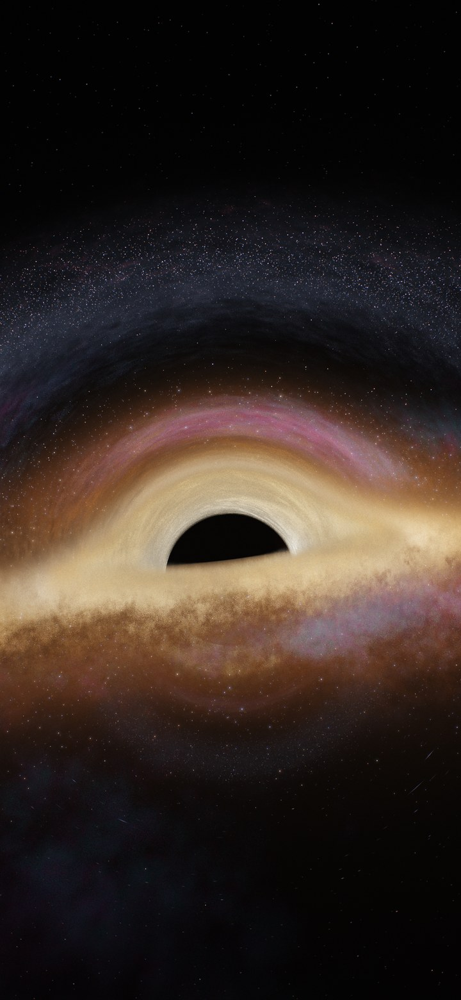

# Gargantua

A small GPU ray tracer for a Schwarzschild (non-rotating) black hole, written with NumPy and CuPy. It renders a vertical phone wallpaper (1440x3120) of a galaxy being swallowed by a "Gargantua"-style disk, and an 8 second video that loops without a seam.



A low-resolution preview of the loop is in [`docs/preview_loop.mp4`](docs/preview_loop.mp4).

## What is physical and what is not

- **Ray paths are physical.** Every pixel's light ray is integrated as a null geodesic in the Schwarzschild metric (G = c = M = 1, horizon at r = 2). With angular momentum h = |x cross v| the ray acceleration is `x'' = -1.5 h^2 x / r^5`, integrated with a leapfrog scheme. The step is adaptive and finer inside the disk. The ray count is one per pixel.
- **Everything else is artistic.** Colours, brightness, the Doppler term, cloud structure, stars, nebulae, arcs of escaping light and the film look are tuned by eye. There is no radiative transfer, no real accretion disk model, and no affine parameter / redshift bookkeeping along the rays.
- **The hole does not spin** (no Kerr metric, no frame dragging).
- **Secondary images are suppressed on purpose.** Light that wraps behind the hole and comes back (higher-order images) is faded out smoothly, because it looked like a hard line and cluttered the picture. The setting is `secondary` / `secondary_fade` in `gargantua/presets.py`.

## How it works

1. **Camera and ray map (`raytrace.py`).** The camera never moves, so the rays are traced once. For each pixel the tracer stores the samples along the part of the ray that is inside the (thick) disk volume, the crossings with a few star sheets, and the way the ray ended (horizon or escape direction).
2. **Fields (`fields.py`).** The disk is a volume built from FFT-filtered, periodic noise in (ln r, azimuth, height): a coarse and a fine cloud field, a self-shadow field and a large-scale patch field. Fine erosion octaves are value noise.
3. **Shading (`shading.py`).** Each frame only repaints: density and emission are evaluated at the stored samples, transmittance is accumulated front to back along each ray, then stars are added. Features include a single colour gradient (cream, amber, orange, rust, dark brown), a heat-exchange layer that counter-rotates, round stars on screen (the lens Jacobian is used so that magnification does not smear them), escaping arcs of light, flare clumps and minimal nebulae.
4. **Post (`post.py`).** Wide glare, red halation, scattered-light veil, chromatic aberration, vignette, ACES tone mapping, and brightness-scaled grain with a different seed per frame.

### Why the loop is seamless

Time `t` runs over one loop, `t` in [0, 1). Every moving feature uses an integer number of cycles per loop:

- Rings rotate differentially. Star rings turn by a multiple of 1/12 of a revolution per loop and the star pattern repeats 12 times around each ring, so the star pattern at `t = 1` is identical to `t = 0`.
- Arcs, flares, shimmer and the sky wobble use integer frequencies in `t`.
- The cloud texture, which cannot repeat by itself under differential rotation, is evaluated at phases `t` and `t - 1` and blended at the field level with a variance-preserving weight (no blurry double image).

## Install

Requirements: Python 3.10+, an NVIDIA GPU with CUDA 12, and `ffmpeg` on the PATH (only for MP4 output).

```
pip install -r requirements.txt
```

`requirements.txt` uses `cupy-cuda12x`; pick the CuPy build that matches your CUDA version.

## Usage

All scripts write to `./output` by default. The cloud noise fields are cached in `output/cache` after the first run.

```
# one frame, 540 px wide, loop phase 0.3
python scripts/render_still.py --preset C --width 540 --time 0.3 --out output/still.png

# low-resolution preview loop (PNG frames + MP4)
python scripts/render_loop_preview.py --preset C --width 360 --seconds 8 --fps 24

# full resolution loop, image split into 12 horizontal bands
python scripts/render_loop_full.py --preset C --width 1440 --seconds 8 --fps 24 --strips 12
```

A full-size single frame: `python scripts/render_still.py --width 1440 --strips 12 --time 0.3`.

`--strips N` splits the image into bands to limit GPU memory. Each band's ray map is built once and kept in host memory; every frame uploads one band at a time. More strips use less VRAM and are slightly slower. `render_loop_full.py` skips frames that already exist, so an interrupted run can be resumed.

The image height is always `width * 3120 / 1440`.

## Presets

Defined in `gargantua/presets.py`:

| Preset | Description |
| --- | --- |
| `A` | Baseline: spiral-arm flow region, Doppler brightening, haze at the inner edge, plain bloom + ACES. |
| `B` | `A` with the front band shaped like a galaxy arm. |
| `C` | `B` plus the heat model, one colour gradient, nebulae, escaping arcs, flare clumps, and the film/camera chain. This is the final look. |

`A` and `B` are earlier steps and are kept because `C` is defined as a modification of `B`, which is a modification of `A`.

## Performance

Measured on an RTX 5060 Ti (16 GB):

- 540 px wide: about 4 s per frame (the ray map takes a few more seconds once).
- 1440x3120: the full 8 s / 192 frame loop takes about 3 hours.
- VRAM is controlled with `--strips`.

The measured timings are for preset `C`. Your numbers depend on the GPU and on the number of strips.

## Project layout

```
gargantua/
  raytrace.py   camera rays, geodesic integration, ray map
  fields.py     FFT cloud fields, shadow field, value noise
  shading.py    density/emission, stars, per-frame painter
  post.py       tone mapping and film effects
  presets.py    parameter presets A, B, C
  render.py     helpers shared by the scripts
scripts/
  render_still.py
  render_loop_preview.py
  render_loop_full.py
docs/           example frame and preview loop
```

## License

MIT, see [LICENSE](LICENSE).
